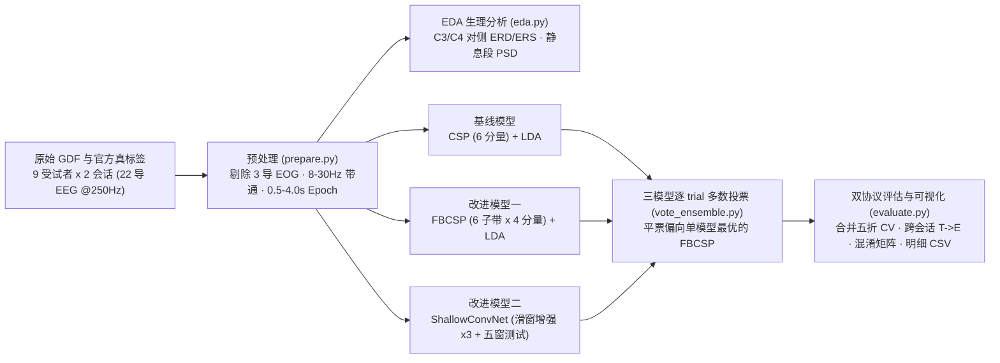
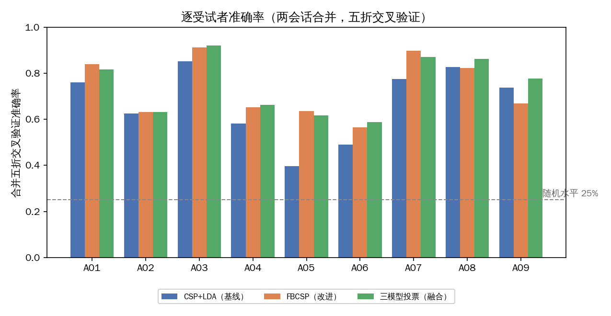
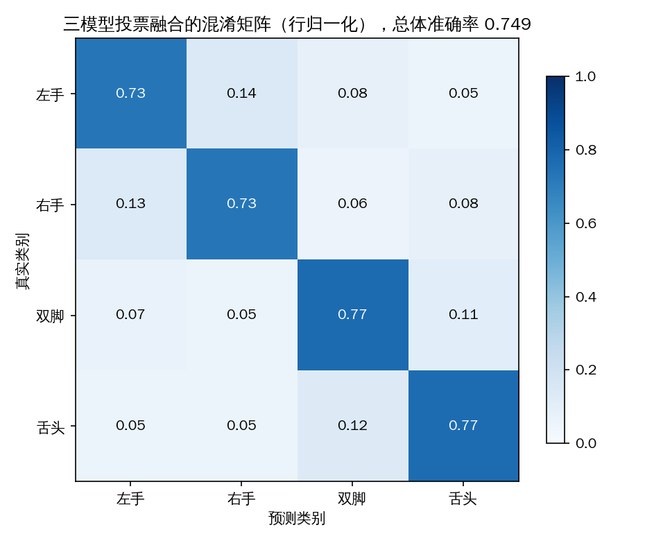
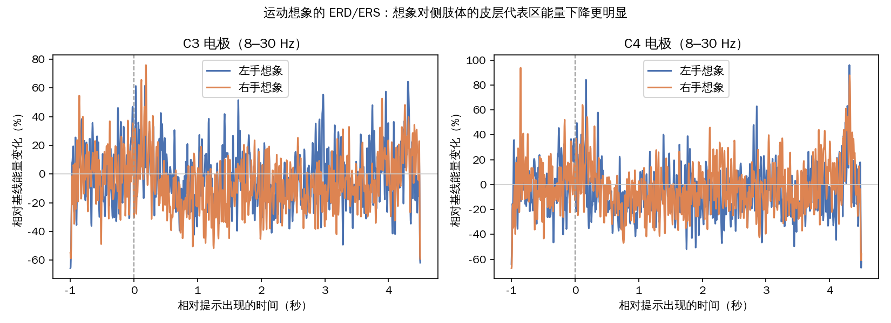
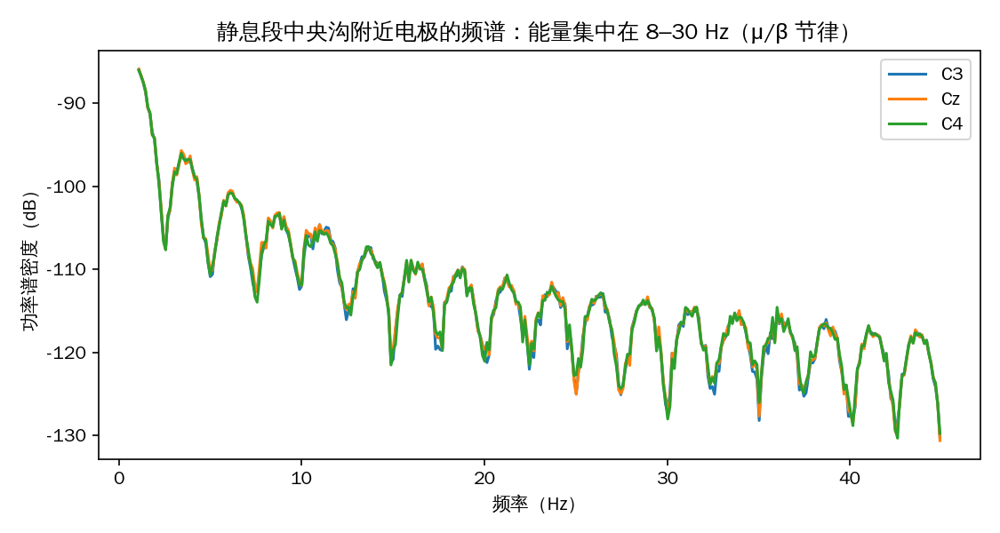

# 基于脑电信号的运动想象四分类（BCI Competition IV 2a）

[](https://github.com/yunyancuo/bci-motor-imagery/actions/workflows/ci.yml)
[](https://www.python.org/)
[](https://www.bbci.de/competition/iv/)
[](https://docs.astral.sh/ruff/)

面向 **BCI Competition IV Dataset 2a** 公开脑电数据集的运动想象四分类（左手 / 右手 / 双脚 / 舌头）完整实验与工程化复现仓库，涵盖 **ERD/ERS 生理特征探索、经典信号处理基线（CSP+LDA）、多子带滤波器组改进（FBCSP）、端到端浅层卷积网络（ShallowConvNet）与三模型多数投票融合**，并在双评估协议下完成 9 名受试者全量验证。

---

## 技术路线图



---

## 实验配置与评估协议

- **数据集**：BCI Competition IV Dataset 2a（Brunner et al., 2008），9 名受试者（`A01`–`A09`）× 2 个独立采集日会话（`T` 训练会话 / `E` 评估会话），22 导 EEG @ 250 Hz（已剔除 3 导 EOG），四类完全均衡（每会话 288 trial，每类 72 trial）。
- **主协议（合并五折分层 CV）**：将单名受试者的 `T` 与 `E` 两会话共 576 trial 合并，执行受试者内五折分层交叉验证（9 人共 5,184 trial；特征拟合与 Z-score 标准化严格限定在训练折内，零跨受试者、零跨折数据泄漏）。
- **附加协议（跨会话泛化 `T → E`）**：完全在 `T` 会话训练、在隔天采集的 `E` 会话测试，用于衡量脑电非平稳性带来的性能衰减与泛化鲁棒性。

---

## 关键实验结果速览（9 名受试者实测）

### 总体性能对比

| 方法 | 特征 / 架构 | 合并五折准确率（均值 ± 标准差） | 合并五折 Cohen's kappa | 跨会话准确率（`T → E`） |
|---|---|---:|---:|---:|
| **CSP+LDA（基线）** | 8–30 Hz，6 分量 CSP + LDA | 0.6715 ± 0.144 | 0.562 | 0.6339 |
| **FBCSP（改进）** | 8–32 Hz，6 × 4 Hz 子带 × 4 分量 + LDA | 0.7361 ± 0.123 | 0.648 | 0.6663 |
| **ShallowConvNet（改进）** | 端到端时空卷积 + 滑窗裁剪 ×3 + 五窗平均 | 0.6712 ± 0.145 | 0.562 | 0.5775 |
| **三模型投票（融合）** | **CSP+LDA + FBCSP + ShallowConvNet 多数投票** | **0.7492 ± 0.119** | **0.666** | **0.6871** |

### 核心结论与误判分析

- **显著超越基线**：三模型投票融合在合并五折与跨会话协议下分别达到 **0.7492**（相对基线 **+7.77 pct**）与 **0.6871**（kappa **0.583**，相对基线 **+5.32 pct**，持平 BCI Competition IV 2a 竞赛冠军水平 kappa ≈ 0.57）。
- **逐受试者表现（融合，合并五折）**：`A03` (0.920) / `A07` (0.870) / `A08` (0.861) / `A01` (0.816) 四名受试者超过 80%；其余为 `A09` (0.776) / `A04` (0.663) / `A02` (0.632) / `A05` (0.616) / `A06` (0.589)，清晰反映运动想象个体差异特征。
- **结构化误判模式**：主协议全部 5,184 个 trial 中正确预测 **3,884** 个（74.9%）；1,300 个误判中，**左手 ↔ 右手**互混 353 个、**双脚 ↔ 舌头**互混 300 个（合计约占一半误差），而“手部类”与“非手部类”之间极少混淆，印证模型有效捕获了皮层空间拓扑差异。

### 关键实验图表预览

<p align="center">
  
  
</p>

<details>
<summary>点击展开：运动想象 ERD/ERS 生理基础与静息段频谱（A01）</summary>
<p align="center">
  
  
</p>
</details>

完整分析与明细请查阅：[实验报告.md](实验报告.md)、[results/测试结果.md](results/测试结果.md)、[BCI脑电实验报告.pdf](BCI脑电实验报告.pdf) 与 [results/vote_predictions.csv](results/vote_predictions.csv)。

---

## 仓库目录结构

```text
bci-motor-imagery/
├── src/
│   ├── __init__.py          # 核心源码包声明
│   ├── metrics.py           # 纯 NumPy 指标（准确率/kappa/混淆矩阵）、分层划分与防泄漏 Z-score
│   ├── cn_font.py           # 跨平台 Matplotlib 中文字体统一配置与优雅回退
│   ├── prepare.py           # GDF + 真标签安全解包与预处理（防 Zip Slip、剔除 EOG、滤波分段）
│   ├── eda.py               # C3/C4 对侧 ERD/ERS 能量变化曲线与静息段 PSD 频谱绘制
│   ├── models.py            # ShallowConvNet 与 EEGNet 深度学习模型定义
│   ├── run_experiment.py    # CSP+LDA / ShallowConvNet / 概率集成双协议统一实验入口
│   ├── fbcsp.py             # 6 子带滤波器组 FBCSP + LDA 训练与评估脚本
│   ├── vote_ensemble.py     # 三模型逐 trial 多数投票融合（含标签对齐一致性校验）
│   └── evaluate.py          # 双协议汇总表、逐受试者柱状图、混淆矩阵与逐 trial 明细导出
├── tests/                   # 离线自动化单元测试套件（合成多通道 EEG 验证零泄漏与边界安全）
├── figures/                 # EDA 生理基础图（ERD/ERS、PSD）
├── results/                 # 实测结果包（summary.csv、vote_predictions.csv、结果图与测试结果.md）
├── report_build/            # 实验报告 DOCX 构建与页脚修补辅助脚本
├── .github/workflows/ci.yml # GitHub Actions 自动化 Lint 与单元测试工作流
├── pyproject.toml           # 项目元数据、Ruff 与 Pytest 工程配置
├── requirements.txt         # Python 运行依赖清单
├── 实验报告.md               # Markdown 版完整实验报告
├── BCI脑电实验报告.docx      # Word 定稿实验报告
└── BCI脑电实验报告.pdf       # PDF 定稿实验报告
```

---

## 快速开始与实验复现

### 1. 环境安装

建议使用 Python 3.10+ 虚拟环境：

```bash
# 安装全量依赖（含 PyTorch，如需国内镜像可追加 -i https://pypi.tuna.tsinghua.edu.cn/simple）
pip install -r requirements.txt

# 若仅需在无 GPU 环境下运行或执行单元测试，可安装轻量 CPU 版 PyTorch
pip install numpy scipy scikit-learn matplotlib mne
pip install --index-url https://download.pytorch.org/whl/cpu torch
```

### 2. 数据获取

从 [BCI Competition IV 官方页面](https://www.bbci.de/competition/iv/) 下载 Dataset 2a 原始 GDF 文件（`A01T.gdf`–`A09E.gdf`）及官方评估集真实标签（`A01E.mat`–`A09E.mat`），放入 `data_src/` 目录。

### 3. 全流程复现指令

```bash
# 1) 数据解包、8–30 Hz 带通滤波与 0.5–4.0 s 分段（输出至 data/bci2a/）
python src/prepare.py --src-dir data_src --out-dir data/bci2a

# 2) 绘制 ERD/ERS 生理特征与静息段功率谱图
python src/eda.py --gdf data_src/Train/A01T.gdf --out-dir figures

# 3) 分别运行三个单模型双协议评估
python src/run_experiment.py --model csp_lda --out-dir outputs/final/csp_lda
python src/run_experiment.py --model shallow --out-dir outputs/final/shallow   # 建议使用 GPU
python src/fbcsp.py          --out-dir outputs/final/fbcsp

# 4) 执行三模型多数投票融合
python src/vote_ensemble.py --in-dir outputs/final --out-dir outputs/final/vote

# 5) 生成汇总表、对比柱状图、混淆矩阵与逐 trial 预测明细
python src/evaluate.py --in-dir outputs/final --out-dir results
```

> **提示**：`src/run_experiment.py` 与 `src/fbcsp.py` 同时支持 `--folds`（默认 `5`）与 `--seed`（默认 `42`）参数；为与下游评估接口保持完全兼容，主协议输出文件沿用 `pooled_cv10.csv` 命名。

---

## 开发与测试指南

本仓库内置基于合成多通道 EEG 信号的离线自动化测试套件，无需下载 420 MB 原始数据集即可验证核心指标、滤波器组频率选择性、零数据泄漏、多数投票对齐防御、Zip Slip 防护与深度网络前向/反传逻辑：

```bash
# 安装开发检查工具
pip install pytest ruff

# 1) 静态代码规范检查
ruff check src tests report_build/patch_footers.py

# 2) 运行离线单元测试套件（缺失可选重型库如 PyTorch 时会自动优雅跳过对应子集）
pytest -v
```

---

## 参考文献

1. Brunner, C., Leeb, R., Müller-Putz, G., Schlögl, A., & Pfurtscheller, G. (2008). *BCI Competition 2008 – Graz data set A*. Institute for Knowledge Discovery, Graz University of Technology.
2. Ang, K. K., Chin, Z. Y., Wang, C., Guan, C., & Zhang, H. (2012). Filter bank common spatial pattern algorithm on BCI competition IV datasets 2a and 2b. *Frontiers in Neuroscience*, 6, 39.
3. Schirrmeister, R. T., et al. (2017). Deep learning with convolutional neural networks for EEG decoding and visualization. *Human Brain Mapping*, 38(11), 5391–5420.
4. Lawhern, V. J., et al. (2018). EEGNet: a compact convolutional neural network for EEG-based brain–computer interfaces. *Journal of Neural Engineering*, 15(5), 056013.
